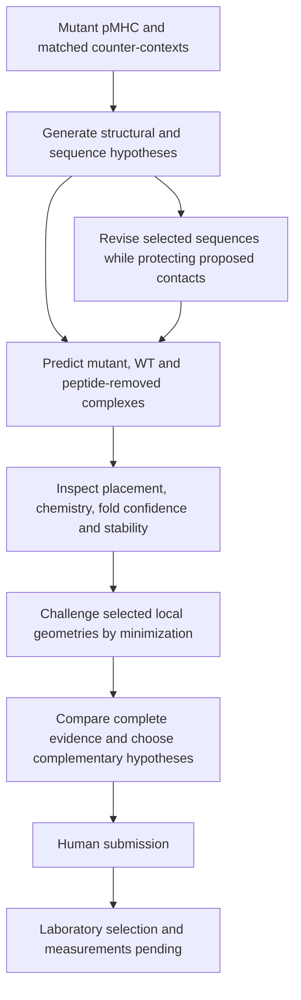

# How the contest workflow worked

The workflow asked whether a designed protein could recognize a one-residue peptide change on a largely shared HLA surface. It combined generation and revision with matched counter-context assessment, followed by candidate-level scientific judgment.

## Instruments and their roles

| Instrument | Use in this campaign | Inspectable output |
|---|---|---|
| RFD4-Proteina | Generate the initial design behind DAG-PMHC-01 | Revision conditioning template and provenance in `supplement/design/` |
| Adapted Odin-Multi / ColabDesign | Generate the initial design behind DAG-PMHC-02 and the fresh DAG-PMHC-03 sequence using mutant and counter-context objectives | Public configurations, target inputs, seeds and weight hashes |
| ProteinMPNN | Sample sequences on fixed structural contexts; preserve designated recognition positions during targeted revision | Fixed/designable positions, decoding order and exact substitutions |
| Boltz2 | Predict complete complexes across four seeds in each target context | All 60 selected-lineage cofold structures and per-seed confidence data |
| FreeSASA and geometric contact analysis | Measure buried surface and atom-level interface observations | Chemistry table, detailed records and atom-specific geometry |
| SaProt stability heads | Compare learned stability diagnostics on mutant-bound binder conformations | All head outputs and matched original/revised comparisons |
| OpenMM | Examine local geometry through restrained and released minimization | Prepared, restrained and released structures and contact tables |
| Language-model-assisted orchestration and independent review | Propose experiments, inspect contradictions, verify claims and prepare readable evidence | The resulting methods, candidate rationale and retained evidence, rather than private conversation logs |

## What changed during revision

DAG-PMHC-01 preserved a predefined peptide-facing sequence network and changed six of eight designable positions. The resulting predictions placed the binder more consistently over the mutant complex. DAG-PMHC-02 preserved the modeled recognition region, including Arg72, while a sampling bias produced A9E and A19T. The experiments compared each revised sequence against its unchanged original under matched assessment settings.

DAG-PMHC-03 explored a fresh sequence using a soluble ProteinMPNN checkpoint within the multi-context generator. The retained checkpoint comparison did not supply a complete matched pair, so this archive does not attribute a molecular improvement to that checkpoint. No model fine-tuning or weight-space edit is claimed.

## How selection used the evidence

We considered the complete mutant and WT comparisons, proposed contact mechanisms, seed variation, surface burial, sequence properties and alternative explanations. We did not rank by a single confidence metric or total minimized energy. Candidate-specific findings are explained in [SUMMARY.md](../SUMMARY.md), with the same underlying values retained in the supplement.

Three choices make the comparison useful to inspect: the originals remain visible, every available selected-lineage context is retained, and the missing relaxation pose remains explicitly unavailable. The three final candidates represent different proposed recognition patterns on the peptide–HLA surface, not three experimentally established epitopes.

## What this campaign taught us

Improved fold or placement diagnostics can coexist with unresolved mutation discrimination. Local minimization can repair mutant and WT contacts alike. A shared-backbone contact can be part of a conformational recognition hypothesis, but needs matched context evidence. Complete attempt accounting prevents failed transport or missing outputs from becoming biological negatives. These lessons motivate future comparisons against physical production, binding and counter-screen measurements; they do not by themselves establish that a revised process produces better drugs.
